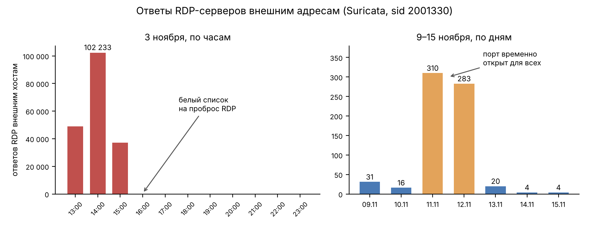

# IDS и защита периметра для небольшой компании без бюджета

Suricata на списанном ПК + зеркало трафика с MikroTik + оповещения на рабочий ПК администратора.
Проект выполнен в действующей сети компании (несколько Windows-серверов с RDP, филиалы по WireGuard,
два провайдера) за две недели. Все адреса и имена в репозитории условные.

Подробное описание проекта, найденных проблем и выводов: [docs/IDS-project-portfolio.docx](docs/IDS-project-portfolio.docx)



*Пик перебора паролей RDP — 102 233 ответа сервера внешним адресам за час. После белого списка и автобана — единицы в сутки.*

## Схема

```
 Интернет ── MikroTik RB5009 ──┬── LAN / серверы / Wi-Fi
              │ port mirror     │
              ▼                 │ syslog (UDP 514), бэкап конфигурации (SSH, read-only)
        Debian 13 + Suricata ◄──┘
              │ SSH, forced command: поток тревог в JSON
              ▼
        ПК администратора (PowerShell): всплывающие оповещения, утренняя сводка
```

## Что внутри

| Файл | Что делает |
|---|---|
| `windows/suricata-alerts.ps1` | Фоновый монитор для Windows: держит SSH-поток тревог, переподключается при зависании (heartbeat), всплывающее окно — только для критических тревог и атак на RDP (сводкой раз в час), остальное — в журнал. Утренняя сводка за сутки. |
| `windows/rdp-audit.ps1` | Аудит входов по RDP на сервере: успешные входы с внешних адресов (4624, 1149), неудачные (4625) по дням, логинам и адресам, сверка «какие логины подбирали» ↔ «под какими вошли». Только чтение. |
| `linux/server-monitoring-setup.sh` | Мониторинг самого сенсора: CPU, память, swap, диск, OOM, падение Suricata (systemd-таймер, события только при смене состояния), оповещение о входе по SSH через PAM, баны fail2ban, поток событий для пользователя `alerts`, logrotate. |
| `linux/mikrotik-backup.sh` + `linux/systemd/` | Еженедельный экспорт конфигурации MikroTik по SSH-ключу с правами только на чтение; проверка, что пришла конфигурация, а не ошибка; хранение 6 месяцев; оповещение при сбое. |
| `linux/rsyslog/` | Приём журналов MikroTik в отдельный файл, хранение 90 дней. |
| `mikrotik/rdp-protection.rsc` | Белый список на проброс RDP, поэтапный автобан перебора, сброс blacklist в raw. |
| `mikrotik/logging-and-backup-user.rsc` | Отправка журналов роутера на сервер без дублей, учётка для бэкапа. |

## Ключевые решения

- **Сенсор на старом железе.** Процессор без SSE4.2 → готовые пакеты Suricata (Hyperscan) не работают → сборка 8.0.6 из исходников, MPM `ac-ks`. Suricata запущена от непривилегированного пользователя с `AmbientCapabilities=CAP_NET_RAW CAP_NET_ADMIN`.
- **Сенсор не в разрыве сети.** Трафик приходит через port mirroring на вторую сетевую карту (AF_PACKET); при отказе сенсора сеть продолжает работать. Контроль потерь пакетов — оповещение при >5%.
- **Минимальные права для оповещений.** У пользователя `alerts` в `authorized_keys` стоит `restrict,command="…"`: по его ключу можно только получать поток тревог, без shell и туннелей. Фильтрация (jq) — на сервере, на ПК уходят только нужные поля.
- **Мало шума.** Всплывают только критические тревоги (троян, C2, эксплойты, повышение прав) и атаки на RDP. Шумные правила понижаются через `modify.conf` — в `eve.json` и EveBox ничего не теряется.

## Грабли, на которые пришлось наступить

| Ситуация | Причина | Решение |
|---|---|---|
| Команда RouterOS «прошла», но ничего не изменила | `[find …]` молча не нашёл ни одного элемента | После каждого изменения — `print` |
| Автобан банил с первого соединения | Правила добавлены с `place-before=0` и встали в обратном порядке | Бан — первым правилом; проверка порядка |
| Автобан забанил 89 своих адресов, у телефонов пропал DNS | Поэтапные правила в `input` без ограничения по WAN | Автобан только на `in-interface-list=WAN` |
| Кириллица в PowerShell 5.1 превращается в мусор | `.ps1` без BOM читается в ANSI | UTF-8 с BOM, CRLF (`.gitattributes`) |
| `auditpol` не принимает имена подкатегорий | Локализованная Windows | GUID подкатегорий |
| Скрипт бэкапа завис и не прерывается Ctrl+C | `timeout` запускает ssh в фоновой группе процессов → чтение терминала → SIGTTIN | `ssh -n` |

## Требования

Debian 12/13, Suricata 7+/8, jq, fail2ban, nftables, rsyslog · RouterOS 7.12+ (ed25519-ключи пользователей) · Windows 10/11 или Server, PowerShell 5.1, встроенный OpenSSH-клиент.

## Перед использованием

Замените условные адреса (`10.0.0.x`, `203.0.113.x`, `198.51.100.x`) на свои. Изменения на MikroTik вносите в Safe Mode и проверяйте через `print`.
